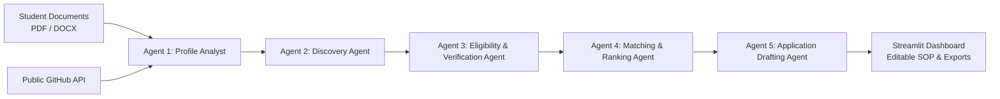

# 🎓 AI Scholarship Finder — Your Study Abroad Funding Assistant
**TetraNoodle AI Hackathon 2026**

[](https://www.python.org/downloads/)
[](https://streamlit.io/)
[](https://docs.pydantic.dev/)
[](https://pytest.org/)
[](https://opensource.org/licenses/MIT)

---

## 1. Project Purpose
The **AI Scholarship Finder** is an autonomous multi-agent research system designed to discover, audit, rank, and draft applications for international postgraduate scholarships and university programs.

Unlike traditional chatbots that hallucinate admissions criteria, fabricate deadlines, or generate unverified promises, this platform operates on a **zero-hallucination, evidence-grounded philosophy**. Every opportunity is verified against official accredited university domains (`.edu`, `.ca`, `.de`, `.sg`), ranked with a transparent 100-point Python formula, and accompanied by verifiable quoted excerpts and timestamps.

---

## 2. Key Features
- **Multi-Agent Collaboration:** Five distinct, cooperating Python agents coordinated by a centralized workflow orchestrator.
- **Local Document Ingestion:** Extracts academic facts and grading scales from PDF resumes and DOCX transcripts locally using `pypdf` and `python-docx`.
- **Public Profile Enrichment:** Seamlessly integrates with the public GitHub REST API to pull active languages, repositories, and technical specializations without mandatory tokens.
- **Official-Source Auditing:** Scrapes and parses official university admission portals, evaluating citizenship constraints, GPA baselines, and intake cycles into four strict statuses: `likely_eligible`, `potential_fit`, `not_eligible`, and `insufficient_information`.
- **Transparent 100-Point Scoring:** Uses an explicit, deterministic Python mathematical formula (Eligibility: 30 pts, Funding: 25 pts, Academic Fit: 15 pts, Skills: 10 pts, Country: 10 pts, Deadline: 10 pts).
- **Application Drafting Studio:** Prepares tailored, grounded Statements of Purpose with zero fabricated achievements, complete with an actionable personalization checklist and DOCX/TXT export.
- **Dual-Profile Demonstration:** Adapts seamlessly between reference student **Rahul Sharma** (BTech CS, 8.2 CGPA, India) and second student **Maria Santos** (Computational Math, 3.85 GPA, Brazil) without altering application logic.

---

## 3. Architecture Overview



### Agent Roles & Source Files
1. **Student Profile Analyst** (`agents/profile_agent.py`): Parses resume/transcript, resolves conflicting CGPAs, marks unknown attributes, and integrates public GitHub data.
2. **Scholarship Discovery Agent** (`agents/discovery_agent.py`): Explores authentic opportunities across student target destinations and deduplicates programs.
3. **Eligibility & Verification Agent** (`agents/eligibility_agent.py`): Performs point-by-point audit against official source websites and categorizes candidates into 4 explicit statuses.
4. **Matching & Ranking Agent** (`agents/matching_agent.py`): Applies hard eligibility exclusions and computes the transparent 100-point prioritization metric.
5. **Application Drafting Agent** (`agents/application_agent.py`): Generates custom Statements of Purpose grounded exclusively in confirmed student facts with DOCX and TXT exports.

---

## 4. Tech Stack
- **Backend & Core:** Python 3.11+, Pydantic v2 (data validation), Tenacity (bounded exponential retry).
- **Frontend Dashboard:** Streamlit 1.52.2 with custom modern CSS cards and badges.
- **AI & Search Grounding:** Google GenAI Python SDK (`google-genai` 2.31.0) with Google Search Grounding support.
- **Document & Web Parsing:** `pypdf`, `python-docx`, `requests`, `beautifulsoup4`.
- **Testing:** `pytest` (24 comprehensive automated unit and resilience tests).

---

## 5. Getting Started (Windows PowerShell Setup)

### Step 1: Clone or Navigate to the Workspace
```powershell
cd "c:\Users\thesa\OneDrive\Desktop\deployment\project\AI Scholarship Finder"
```

### Step 2: Install Required Dependencies
```powershell
python -m pip install -r requirements.txt
```

### Step 3: Configure Environment Variables (Optional)
The system includes an intelligent **Demonstration Mode** that runs out-of-the-box using validated local intelligence without requiring external API keys.

To enable live Gemini reasoning and search grounding:
1. Copy the template:
   ```powershell
   Copy-Item .env.example .env
   ```
2. Obtain a free Gemini API key from [Google AI Studio](https://aistudio.google.com/app/apikey).
3. Open `.env` and configure your key:
   ```env
   GEMINI_API_KEY=your_actual_gemini_api_key_here
   GEMINI_MODEL=gemini-2.5-flash
   ```
*(Note: Never paste your real secret into this chat or commit it to Git).*

### Step 4: Run the Automated Test Suite
Verify that all 24 automated unit, integration, and recovery tests pass:
```powershell
python -m pytest tests -v
```

### Step 5: Launch the Web Application
```powershell
streamlit run app.py
```
Open your browser to `http://localhost:8501`.

---

## 6. Demonstration & Evaluation Guide

### Preset Student Profiles
- **Profile 1 (Reference): Rahul Sharma**
  - BTech in Computer Science, 8.2 / 10.0 CGPA, AI/ML focus.
  - Target: Master of Science in Canada, Germany, Singapore with substantial funding.
  - *Click "Load Rahul (Reference)" in the sidebar to populate instant test data.*
- **Profile 2 (Second Profile Adaptation): Maria Santos**
  - BSc in Computational Mathematics, 3.85 / 4.0 GPA, Brazilian nationality.
  - Target: Master of Science in Germany and Canada with research fellowship.
  - *Click "Load Maria (Profile 2)" to demonstrate dynamic ranking adaptation without code changes.*

---

## 7. Security, Privacy & Integrity Notes
- **Git Safety:** Sensitive files (`.env`, `.streamlit/secrets.toml`, local caches, private uploads) are strictly excluded via `.gitignore`.
- **Zero Hallucination Guarantee:** The Application Drafting Agent is prohibited from manufacturing co-authored papers, false test scores, or imaginary awards. Placeholders (e.g. `[Insert Professor Name]`) are provided where personal reflection is needed.
- **Untrusted Web Content Sanitization:** External university portal text is passed through `SourceVerifier.sanitize_untrusted_text()` to redact potential prompt injection attempts.
- **Session Privacy:** Uploaded documents are parsed locally in memory. Users can click "🧹 Clear Uploads & Reset Session" to purge temporary data at any time.

---

## 8. Hackathon Deliverables Sitemap
- `coordinator.py`: Central multi-agent workflow coordinator.
- `app.py`: Streamlit user interface with real-time observability.
- `docs/architecture.md`: Full architectural documentation and Mermaid diagrams.
- `docs/experiment.md`: Benchmark comparison (Single-Prompt vs Multi-Agent) and challenge note.
- `docs/demo_guide.md`: 5-minute presentation script and screen action checklist.
- `data/sample_documents/`: Generated sample PDF resume and DOCX transcript for testing.

---

## 9. Production API foundation (in progress)

The original Streamlit application remains the demo interface. A separate,
modular FastAPI foundation now lives in `backend/`, with versioned routes,
PostgreSQL migrations, OIDC-token verification, ownership-scoped profile and
workflow access, durable workflow records/events, and a Celery/Redis worker
boundary. Start the local service dependencies with:

```powershell
docker compose -f infrastructure/compose.yaml up --build
```

Set API configuration in `.env` from `.env.example`, then apply migrations before
accepting requests:

```powershell
docker compose -f infrastructure/compose.yaml run --rm api alembic upgrade head
```

This foundation does **not** yet make the legacy Streamlit UI a production
deployment. A Next.js landing interface and LangGraph topology are included, but
secure upload object storage, concrete worker-node integrations/checkpoint
persistence, and live OIDC provider configuration remain required before a public release. See `docs/api.md`,
`docs/security.md`, and `docs/operations.md`.
