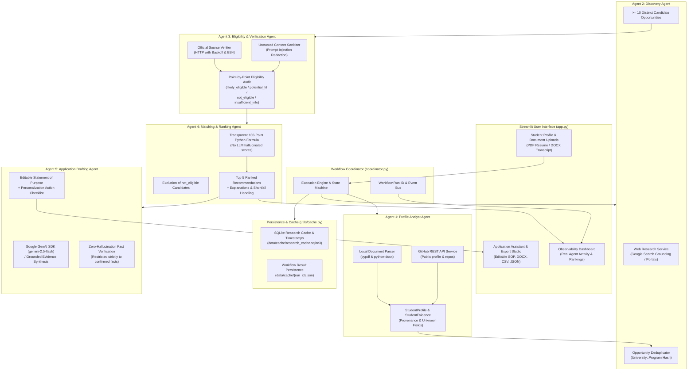

# AI Scholarship Finder — Architecture Documentation
**TetraNoodle AI Hackathon 2026**

## 1. System Overview
The **AI Scholarship Finder** is an end-to-end multi-agent system designed to assist students seeking postgraduate education abroad with verified, source-grounded scholarships and university programs.

Instead of relying on a single generative prompt that hallucinates eligibility criteria or application deadlines, this system coordinates **five specialized agents**, each with dedicated responsibilities, structured Pydantic data schemas, bounded retry error handling, and strict evidence provenance.

---

## 2. Multi-Agent Architecture Diagram

---

## 3. Agent Responsibilities & Data Contracts

| Agent | Module | Input Schema | Output Schema | Primary Tools / Services |
| :--- | :--- | :--- | :--- | :--- |
| **1. Profile Analyst** | `agents/profile_agent.py` | Uploaded PDF/DOCX or manual overrides | `StudentProfile`, `List[StudentEvidence]` | `DocumentParser`, `GitHubService` |
| **2. Discovery Agent** | `agents/discovery_agent.py` | `StudentProfile` | `List[Opportunity]` (>= 10 candidates) | `WebResearchService`, `GeminiClient` |
| **3. Eligibility Agent** | `agents/eligibility_agent.py` | `Opportunity`, `StudentProfile` | `EligibilityAssessment`, `SourceEvidence` | `SourceVerifier`, `requests`, `bs4` |
| **4. Matching & Ranking** | `agents/matching_agent.py` | Verified `List[Opportunity]`, `StudentProfile` | Top 5 `Opportunity` + `MatchScore` | `utils.scoring.calculate_match_score` |
| **5. Application Drafting** | `agents/application_agent.py` | Selected `Opportunity`, `StudentProfile` | `ApplicationDraft` | `GeminiClient`, `python-docx` export |

---

## 4. Transparent 100-Point Scoring Formula

The matching agent strictly implements the Python-based scoring algorithm from explicit, validated fields:

$$\text{Total Score} = S_{\text{eligibility}} + S_{\text{funding}} + S_{\text{academic}} + S_{\text{skills}} + S_{\text{country}} + S_{\text{readiness}}$$

1. **Eligibility Evidence (Max 30 pts):**
   - `likely_eligible` with official source direct support: **30 pts**
   - `likely_eligible` (unconfirmed): **26 pts**
   - `potential_fit` (pending criteria/nomination): **16 pts**
   - `insufficient_information`: **6 pts**
   - `not_eligible`: **0 pts** *(Hard excluded from top 5 recommendations)*
2. **Funding Suitability (Max 25 pts):**
   - Full Tuition + Living Stipend: **25 pts**
   - Full Tuition: **20 pts**
   - Substantial Partial Award: **15 pts**
   - Merit Award: **12 pts**
   - Need-based / Fee Waiver: **10 pts**
3. **Academic & Subject Fit (Max 15 pts):**
   - Degree level match (e.g. Master's to Master's): **7.5 pts**
   - Subject alignment (CS / AI / Informatics): **7.5 pts**
4. **Skills & Project Relevance (Max 10 pts):**
   - Overlap of verified skills/projects with opportunity domain: **4 to 10 pts**
5. **Preferred Country Fit (Max 10 pts):**
   - Direct match in student's preferred country list: **10 pts**
   - Non-preferred destination: **2 pts**
6. **Deadline & Application Readiness (Max 10 pts):**
   - Open active cycle: **10 pts**
   - Rolling admissions: **9 pts**
   - Future intake cycle: **7 pts**
   - Unconfirmed: **3 pts**
   - Closed cycle: **0 pts**

---

## 5. Security & Trust Architecture
1. **Untrusted Data Sanitization:** All external web text scraped from live university portals is passed through `SourceVerifier.sanitize_untrusted_text()`, stripping scripts, HTML tags, and prompt injection attempts before model reasoning.
2. **Credential Safety:** Secrets are managed strictly through `.env` and `config.py`. Keys are never logged, committed to Git, or exposed in UI error strings.
3. **Session Privacy:** Uploaded documents are parsed in memory or temporary session directories, with a one-click session reset clearing all cached user data.
